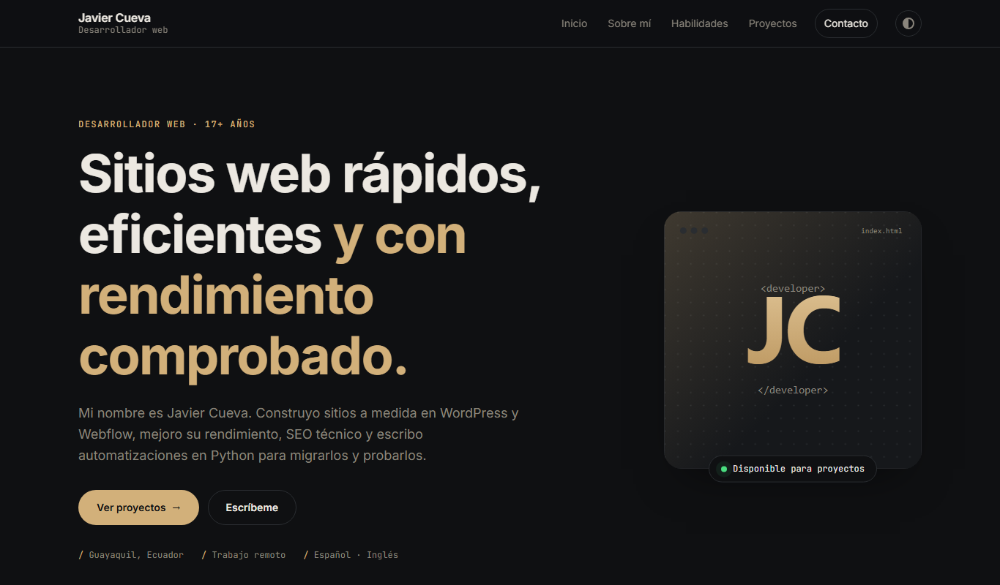

# Portafolio web · Javier Cueva

Portafolio personal en HTML y CSS. Actividad integradora 1 de Programación de Sistemas Web, Universidad Ecotec.

- **Estudiante:** Javier Cueva
- **Sitio publicado:** https://javierfcueva.github.io/portafolio-web/



## Secciones

- Encabezado con nombre, profesión y menú
- Sección principal con presentación y avatar
- Sobre mí
- Habilidades
- Proyectos
- Contacto (formulario visual, no envía datos)
- Pie de página

## Tecnologías

- HTML5 semántico: `header`, `nav`, `main`, `section`, `article`, `footer`
- CSS3: variables en `:root`, Flexbox, Grid, `:hover` y media queries
- Tema claro y oscuro con `light-dark()` y `:has()`, sin JavaScript
- Animaciones al hacer scroll con `animation-timeline`
- Tipografías Inter y JetBrains Mono (Google Fonts)

## Cómo verlo

- En línea: abrir https://javierfcueva.github.io/portafolio-web/
- En local: clonar el repositorio y abrir `index.html` en el navegador.

```
git clone https://github.com/javierfcueva/portafolio-web.git
```

## Estructura

```
portafolio-web/
├── index.html    # Página principal
├── styles.css    # Hoja de estilos externa
├── img/          # Avatar, ilustraciones de proyectos, favicon y captura
└── README.md
```
